<!-- GENERATED FILE - edit src/ instead (node build/build.mjs) -->
<div align="center">

<h1><a href="https://modoo.today"><picture><source media="(prefers-color-scheme: dark)" srcset="https://raw.githubusercontent.com/modootoday/.github/main/profile/assets/hero-dark.svg"></picture></a></h1>

<picture><source media="(prefers-color-scheme: dark)" srcset="https://raw.githubusercontent.com/modootoday/.github/main/profile/assets/status-dark.svg"></picture>

</div>

**모두의오늘**은 대표 개발자 최원이 운영하는 1인 기업입니다. 브랜드 콘텐츠를 기획·제작·발행하고, 그 성과를 다음 콘텐츠에 반영하는 흐름을 하나의 AI OS로 만듭니다. 창작자·사업자용 서비스와 개발자용 오픈소스 도구를 함께 만듭니다.

<picture><source media="(prefers-color-scheme: dark)" srcset="https://raw.githubusercontent.com/modootoday/.github/main/profile/assets/divider-flow-dark.svg"></picture>

<h2><picture><source media="(prefers-color-scheme: dark)" srcset="https://raw.githubusercontent.com/modootoday/.github/main/profile/assets/sec-services-dark.svg"></picture></h2>

<p align="center">
<a href="https://modoo.today"><picture><source media="(prefers-color-scheme: dark)" srcset="https://raw.githubusercontent.com/modootoday/.github/main/profile/assets/card-modoo-dark.svg"></picture></a>
<a href="https://biz.modoo.today"><picture><source media="(prefers-color-scheme: dark)" srcset="https://raw.githubusercontent.com/modootoday/.github/main/profile/assets/card-biz-dark.svg"></picture></a>
<a href="https://ink.minago.blog/en"><picture><source media="(prefers-color-scheme: dark)" srcset="https://raw.githubusercontent.com/modootoday/.github/main/profile/assets/card-ink-dark.svg"></picture></a>
<a href="https://github.com/modootoday/kinekino"><picture><source media="(prefers-color-scheme: dark)" srcset="https://raw.githubusercontent.com/modootoday/.github/main/profile/assets/card-kinekino-dark.svg"></picture></a>
<a href="https://skills.modoo.today"><picture><source media="(prefers-color-scheme: dark)" srcset="https://raw.githubusercontent.com/modootoday/.github/main/profile/assets/card-skills-dark.svg"></picture></a>
<a href="https://datalab.tools"><picture><source media="(prefers-color-scheme: dark)" srcset="https://raw.githubusercontent.com/modootoday/.github/main/profile/assets/card-datalab-dark.svg"></picture></a>
<a href="https://codex.datalab.tools"><picture><source media="(prefers-color-scheme: dark)" srcset="https://raw.githubusercontent.com/modootoday/.github/main/profile/assets/card-codex-dark.svg"></picture></a>
<a href="https://envs.build"><picture><source media="(prefers-color-scheme: dark)" srcset="https://raw.githubusercontent.com/modootoday/.github/main/profile/assets/card-envs-dark.svg"></picture></a>
<a href="https://specfold.build"><picture><source media="(prefers-color-scheme: dark)" srcset="https://raw.githubusercontent.com/modootoday/.github/main/profile/assets/card-specfold-dark.svg"></picture></a>
<a href="https://pmcp.build"><picture><source media="(prefers-color-scheme: dark)" srcset="https://raw.githubusercontent.com/modootoday/.github/main/profile/assets/card-pmcp-dark.svg"></picture></a>
<a href="https://humanymous.net"><picture><source media="(prefers-color-scheme: dark)" srcset="https://raw.githubusercontent.com/modootoday/.github/main/profile/assets/card-humanymous-dark.svg"></picture></a>
<a href="https://github.com/modootoday/meari"><picture><source media="(prefers-color-scheme: dark)" srcset="https://raw.githubusercontent.com/modootoday/.github/main/profile/assets/card-meari-dark.svg"></picture></a>
</p>

<table width="100%">
<tr><th width="20%" align="left">서비스</th><th width="18%" align="left">대상</th><th width="37%" align="left">한 줄 소개</th><th width="25%" align="left">링크</th></tr>
<tr><td>모두의오늘</td><td>창작자</td><td>브랜드 콘텐츠를 운영하는 통합 AI OS<br><sub>Write · Card · Motion · Voice · Market</sub></td><td><a href="https://modoo.today" title="모두의오늘 웹사이트">웹사이트</a><br><sub>modoo.today</sub></td></tr>
<tr><td>모두의오늘 비즈</td><td>사업자·대행사</td><td>브랜드의 오늘을, 근거가 남는 운영 결과로.<br><sub>제작 · 검토 · 승인 · 발행 · 고객사별 데이터 분리</sub></td><td><a href="https://biz.modoo.today" title="모두의오늘 비즈 웹사이트">웹사이트</a><br><sub>biz.modoo.today</sub></td></tr>
<tr><td>Minago Ink</td><td>창작자</td><td>내 글로 말투를 배우는 AI 대필 작가<br><sub>Written like you, minutes ago.</sub></td><td><a href="https://ink.minago.blog/en" title="Minago Ink 웹사이트">웹사이트</a><br><sub>ink.minago.blog</sub></td></tr>
<tr><td>kinekino</td><td>창작자</td><td>영상 보기, 자막, 클립 편집을 한 도구에서 하는 AI 플레이어 (pre-alpha)<br><sub>자막 · 구간 감지 · 클립 · 로컬 모델 · pre-alpha</sub></td><td><a href="https://github.com/modootoday/kinekino" title="kinekino 저장소">저장소</a><br><sub>modootoday/kinekino</sub></td></tr>
<tr><td>모두의오늘 스킬</td><td>AI 사용자</td><td>508개 스킬을 골라 읽는 MCP 커넥터<br><sub>Claude · ChatGPT · Codex</sub></td><td><a href="https://skills.modoo.today" title="모두의오늘 스킬 웹사이트">웹사이트</a><br><sub>skills.modoo.today</sub></td></tr>
<tr><td>데이터랩툴즈 헬퍼</td><td>창작자·마케터</td><td>보던 화면을 분석 도구로 바꾸는 브라우저 헬퍼<br><sub>위젯 143개 · AIO 사이드패널 · MCP 브리지</sub></td><td><a href="https://datalab.tools" title="데이터랩툴즈 헬퍼 웹사이트">웹사이트</a><br><sub>datalab.tools</sub></td></tr>
<tr><td>SOLA Codex</td><td>데이터·분석</td><td>콘텐츠 품질 점수 계산 방식 공개 문서<br><sub>가이드북 · 분류 체계 · 용어집</sub></td><td><a href="https://codex.datalab.tools" title="SOLA Codex 웹사이트">웹사이트</a><br><sub>codex.datalab.tools</sub></td></tr>
<tr><td>envs</td><td>개발자</td><td><code>.env</code>를 암호화된 카탈로그 하나로<br><sub>$ npx @modootoday/envs init</sub></td><td><a href="https://envs.build" title="envs 웹사이트">웹사이트</a><br><a href="https://github.com/modootoday/envs" title="envs 저장소">저장소</a><br><sub>envs.build</sub></td></tr>
<tr><td>specfold</td><td>개발자</td><td>설계 문서를 코드와 함께, <code>spec check</code><br><sub>$ spec check</sub></td><td><a href="https://specfold.build" title="specfold 웹사이트">웹사이트</a><br><a href="https://github.com/modootoday/specfold" title="specfold 저장소">저장소</a><br><sub>specfold.build</sub></td></tr>
<tr><td>pmcp</td><td>개발자</td><td>AI CLI 밑의 스킬·설정·메일박스 레이어<br><sub>pmcp.toml</sub></td><td><a href="https://pmcp.build" title="pmcp 웹사이트">웹사이트</a><br><a href="https://github.com/modootoday/pmcp" title="pmcp 저장소">저장소</a><br><sub>pmcp.build</sub></td></tr>
<tr><td>humanymous</td><td>개발자</td><td>봇과 사람을 구분하는 Gate (Apache-2.0)<br><sub>Apache-2.0 · 문서</sub></td><td><a href="https://humanymous.net" title="humanymous 웹사이트">웹사이트</a><br><a href="https://github.com/modootoday/humanymous" title="humanymous 저장소">저장소</a><br><sub>humanymous.net</sub></td></tr>
<tr><td>Meari</td><td>개발자</td><td>React·Tailwind 디자인 계약을 쓰는 Rust UI 프레임워크 (개발 중)<br><sub>Rust · Native/Web 빌더 · Apache-2.0 · 개발 중</sub></td><td><a href="https://github.com/modootoday/meari" title="Meari 저장소">저장소</a><br><sub>modootoday/meari</sub></td></tr>
</table>

<details><summary><b>그 밖의 공개 저장소</b></summary>

[marketplace](https://github.com/modootoday/marketplace) — Claude Code·Codex CLI·Grok CLI에서 똑같이 동작하는 에이전트 플러그인 · [datalab-extension-mcp](https://github.com/modootoday/datalab-extension-mcp) · [jekyll-theme-modootoday](https://github.com/modootoday/jekyll-theme-modootoday) · [devtools-public](https://github.com/modootoday/devtools-public)

</details>

<picture><source media="(prefers-color-scheme: dark)" srcset="https://raw.githubusercontent.com/modootoday/.github/main/profile/assets/divider-circuit-dark.svg"></picture>

<h2><picture><source media="(prefers-color-scheme: dark)" srcset="https://raw.githubusercontent.com/modootoday/.github/main/profile/assets/sec-flow-dark.svg"></picture></h2>

<picture><source media="(prefers-color-scheme: dark)" srcset="https://raw.githubusercontent.com/modootoday/.github/main/profile/assets/flow-dark.svg">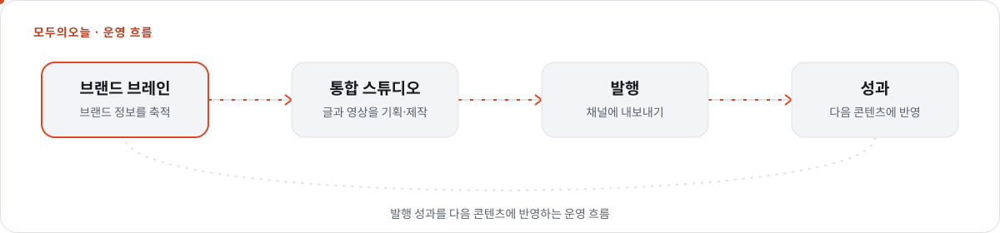</picture>

<details><summary>운영 흐름을 글로 보기</summary>

1. **브랜드 브레인** — 브랜드 정보를 축적
2. **통합 스튜디오** — 글과 영상을 기획·제작
3. **발행** — 채널에 내보내기
4. **성과** — 다음 콘텐츠에 반영하고, 다시 1단계로 이어집니다

</details>

개발자 도구는 터미널에서 바로 씁니다.

<picture><source media="(prefers-color-scheme: dark)" srcset="https://raw.githubusercontent.com/modootoday/.github/main/profile/assets/terminal-dark.svg"></picture>

<details><summary>터미널 화면을 글로 보기</summary>

```sh
$ npx @modootoday/envs init
# 프로젝트의 .env 값을 암호화된 카탈로그로
$ spec check
# 프로젝트 문서를 규칙에 맞춰 검사합니다
```

</details>

<picture><source media="(prefers-color-scheme: dark)" srcset="https://raw.githubusercontent.com/modootoday/.github/main/profile/assets/divider-pulse-dark.svg"></picture>

<h2><picture><source media="(prefers-color-scheme: dark)" srcset="https://raw.githubusercontent.com/modootoday/.github/main/profile/assets/sec-activity-dark.svg"></picture></h2>

<picture><source media="(prefers-color-scheme: dark)" srcset="https://raw.githubusercontent.com/modootoday/.github/main/profile/assets/activity-dark.svg"></picture>

<details><summary>최근 활동을 글로 보기 (2026-11-08 21:29 KST 기준)</summary>

- <a href="https://github.com/modootoday/meari">meari</a>: chore: record patched shell source provenance (16시간 전)
- <a href="https://github.com/modootoday/meari">meari</a>: chore: prepare 0.3.0 release (17시간 전)
- <a href="https://github.com/modootoday/jekyll-theme-modootoday">jekyll-theme-modootoday</a>: fix(blog): a list post list keeps the cover ratio so rows do not shift (2일 전)
- <a href="https://github.com/modootoday/jekyll-theme-modootoday">jekyll-theme-modootoday</a>: docs(components): the Components index shows the cards-4 source (2일 전)
- <a href="https://github.com/modootoday/jekyll-theme-modootoday">jekyll-theme-modootoday</a>: feat(starters): render the demo overlay and a guarded demo layering step (2일 전)
- <a href="https://github.com/modootoday/jekyll-theme-modootoday">jekyll-theme-modootoday</a>: fix(i18n): the Korean showcase names the theme 모두의오늘 테마 (2일 전)
- <a href="https://github.com/modootoday/specfold">specfold</a>: release: 0.7.2 (3일 전)
- <a href="https://github.com/modootoday/specfold">specfold</a>: fix(D1): compile governs once per run, so big changes stay fast (3일 전)

</details>

<sub>공개 저장소 커밋만 표시하며, 6시간마다 자동으로 갱신됩니다.</sub>

<h2><picture><source media="(prefers-color-scheme: dark)" srcset="https://raw.githubusercontent.com/modootoday/.github/main/profile/assets/sec-maker-dark.svg"></picture></h2>

<a href="https://github.com/myso-kr"><picture><source media="(prefers-color-scheme: dark)" srcset="https://raw.githubusercontent.com/modootoday/.github/main/profile/assets/maker-dark.svg"></picture></a>

**최원** · 모두의오늘 대표 · 개발자 (<a href="https://github.com/myso-kr">GitHub: myso-kr</a>). 기획부터 개발, 출시와 운영까지 혼자 맡는 1인 기업입니다. 창작자 서비스, 사업자용 플랫폼, 개발자 CLI를 함께 만듭니다. 주로 쓰는 기술: TypeScript, Rust, Go.

- 모든 서비스와 도구는 계속 발전 중입니다. 버그나 아이디어는 각 저장소의 Issues에 남겨 주세요.
- 도입·협업 문의는 메일로 받습니다.

<h2><picture><source media="(prefers-color-scheme: dark)" srcset="https://raw.githubusercontent.com/modootoday/.github/main/profile/assets/sec-contact-dark.svg"></picture></h2>

<p align="center">
<a href="mailto:support@modoo.today"><picture><source media="(prefers-color-scheme: dark)" srcset="https://raw.githubusercontent.com/modootoday/.github/main/profile/assets/contact-mail-dark.svg"></picture></a>
<a href="https://github.com/modootoday"><picture><source media="(prefers-color-scheme: dark)" srcset="https://raw.githubusercontent.com/modootoday/.github/main/profile/assets/contact-github-dark.svg"></picture></a>
<a href="https://x.com/datalab_tools"><picture><source media="(prefers-color-scheme: dark)" srcset="https://raw.githubusercontent.com/modootoday/.github/main/profile/assets/contact-x-dark.svg"></picture></a>
</p>
<!-- 나중에 추가할 자리: src/data/site.json 의 contact_later 항목(블로그·뉴스레터)을 contact 로 옮기면 카드가 생깁니다.
블로그: https://... (contact-blog)
뉴스레터: https://... (contact-news)
-->

<p align="center">
<a href="https://www.npmjs.com/~modootoday"><picture><source media="(prefers-color-scheme: dark)" srcset="https://raw.githubusercontent.com/modootoday/.github/main/profile/assets/contact-npm-dark.svg"></picture></a>
<a href="https://crates.io/users/myso-kr"><picture><source media="(prefers-color-scheme: dark)" srcset="https://raw.githubusercontent.com/modootoday/.github/main/profile/assets/contact-crates-dark.svg"></picture></a>
<a href="https://rubygems.org/profiles/modootoday"><picture><source media="(prefers-color-scheme: dark)" srcset="https://raw.githubusercontent.com/modootoday/.github/main/profile/assets/contact-rubygems-dark.svg"></picture></a>
</p>

패키지 npm <a href="https://www.npmjs.com/~modootoday">npmjs.com/~modootoday</a> · crates.io <a href="https://crates.io/users/myso-kr">crates.io/users/myso-kr</a> · RubyGems <a href="https://rubygems.org/profiles/modootoday">rubygems.org/profiles/modootoday</a>

문의 <a href="mailto:support@modoo.today">support@modoo.today</a> · GitHub <a href="https://github.com/modootoday">@modootoday</a> · <a href="https://github.com/myso-kr">@myso-kr</a> · X <a href="https://x.com/datalab_tools">x.com/datalab_tools</a>

<div align="center">

[](https://modoo.today) 

<picture><source media="(prefers-color-scheme: dark)" srcset="https://raw.githubusercontent.com/modootoday/.github/main/profile/assets/footer-dark.svg"></picture>

</div>
